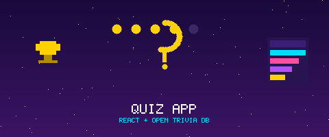

<div align="center">
  

  [](https://reactjs.org/)
  [](https://developer.mozilla.org/en-US/docs/Web/JavaScript)
  [](https://storybook.js.org/)

  **🧠 Trivia quiz app with a countdown timer, star rating, and randomized answers — powered by the Open Trivia DB 🏆**

</div>

---

## ✨ Features

- ❓ **Live trivia questions** fetched from the [Open Trivia Database](https://opentdb.com) — easy difficulty, multiple choice
- 🔀 **Randomized answers** — shuffled with Fisher-Yates on every question
- ⏱️ **Countdown timer bar** — visual pressure per question
- ⭐ **Star rating** — score shown as stars at the end
- 🏆 **Trophy screen** — final score celebration
- 📖 **Storybook** — stories for the Button component

## 🚀 Quick Start

```bash
npm install
npm start
```

Open `http://localhost:3000`.

## 📖 Storybook

```bash
npm run storybook
```

Open `http://localhost:6006` to browse components in isolation.

## 🛠️ Tech Stack

- **React 17**
- **Open Trivia Database API** — free, no key required
- **Storybook v6**
- **React Testing Library**
- **Create React App**
